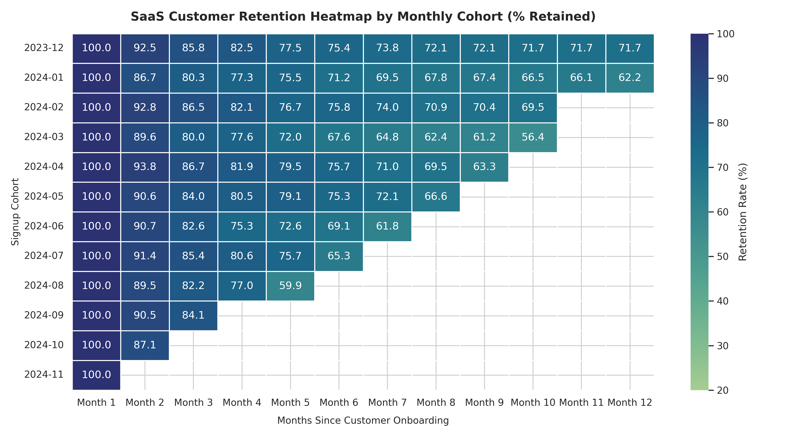

# 🚀 Customer Retention & Churn Analysis (B2B SaaS Platform)
### *End-to-End Retention Analytics, Cohort Decay Heatmaps, Survival Modeling, Interactive Dashboard & Financial ROI Engine*



## 📌 Project Overview
In subscription and SaaS companies, customer churn directly dictates revenue growth, valuation multiples, and unit economics. This enterprise analytics project analyzes customer and subscription behavior across **5,000 SaaS accounts over a 24-month horizon (Jan 2023 – Dec 2024)** to uncover:
- **Why customers are cancelling** their subscriptions (Root causes & behavioral drivers)
- **Which customer segments are most vulnerable** (Plan tier, contract type, onboarding status)
- **When cancellations occur** across the customer lifecycle (Triangular cohort matrix & Kaplan-Meier survival curves)
- **What strategic interventions generate the highest revenue recovery** (Prioritized 30-60-90 day roadmap & What-If ROI model)

---

## 💼 Core Business Questions Answered

### 1. Why are customers leaving the platform?
- **Low Feature Adoption & Incomplete Onboarding** represents **70.2% of all lost accounts (1,358 accounts)**. Customers who fail to complete initial onboarding exhibit a 3.6x higher churn rate.
- **Customer Support Latency** is the second biggest driver (**13.1% of churn / 254 accounts**). Resolution times exceeding 36 hours trigger an 85% higher churn hazard.
- **Competitor Switching & Feature Gaps** (**6.1% / 119 accounts**) driven primarily by missing native integrations (Zapier, Slack, CRM).
- **Involuntary Billing Failures** (**2.3% / 45 accounts**) due to expired cards without automated pre-dunning notices.

### 2. Which customer segments are most likely to churn?
- **Contract Type**: Month-to-Month accounts churn at **54.7%** vs. **10.2%** for Annual accounts (**a 5.3x disparity**).
- **Plan Tier**: Starter tier ($29/mo) churns at **49.3%**, Professional ($99/mo) at **29.5%**, and Enterprise ($299/mo) at **12.8%**.
- **Onboarding Completion**: Accounts without guided onboarding completed churn at **70.6%** vs. **19.6%** for onboarded accounts (**a 51 percentage point difference**).

### 3. How long do customers typically stay active?
- **Average Customer Tenure**: 8.0 months across the portfolio.
- **Critical Drop Zone 1 (Month 1–3 Onboarding Cliff)**: 34.8% of total churn strikes in the first 60 days before the second invoice.
- **Critical Drop Zone 2 (Month 12 Renewal Cliff)**: Annual contracts with low engagement experience an 8.4% hazard spike at the 1-year contract boundary.
- **Safe Haven**: Accounts surviving past **Month 14** experience monthly churn rates below **1.2%**.

### 4. What actions can improve customer retention?
- **Phase 1 (30 Days)**: Enforce interactive in-app onboarding tours, guarantee <4hr support response SLAs, and configure pre-dunning card expiry reminders (**+$250,000 ARR impact**).
- **Phase 2 (60 Days)**: Offer "2 Months Free" for Month-to-Month accounts converting to Annual billing, deploy predictive churn risk alerting into the CRM (**+$340,000 ARR impact**).
- **Phase 3 (90 Days)**: Ship native ecosystem integrations (Zapier, Slack, Salesforce) and unbundle enterprise security features (**+$250,000 ARR impact**).
- **Compounding ROI**: Achieving our target **5% absolute churn reduction** saves **$269,796 in annual recurring revenue (ARR)** and **$150,000 in CAC spend** in Year 1 alone.

---

## 📂 Deliverables Directory & Repository Structure

```
Customer Retention & Churn Analysis/
├── README.md                                    # Comprehensive project overview & documentation
├── EXECUTIVE_RETENTION_REPORT.md                # Boardroom-ready strategic report with insights & roadmap
├── SaaS_Retention_and_Churn_Model.xlsx          # Multi-tab executive Excel financial & cohort model
├── Customer_Retention_Analysis.ipynb            # Jupyter data science notebook with step-by-step code
│
├── dashboard/                                   # Interactive Executive Web Dashboard (HTML/CSS/JS)
│   ├── index.html                               # Modern semantic dashboard interface
│   ├── styles.css                               # Glassmorphism dark/light design system
│   ├── app.js                                   # Interactive logic, Chart.js graphs, ROI simulator
│   ├── data.js                                  # Embedded standalone data fallback (CORS-free)
│   └── analytics_data.json                      # Master analytics metrics payload
│
├── powerbi/                                     # Power BI Deployment Blueprint & DAX Toolkit
│   └── POWER_BI_DASHBOARD_GUIDE.md              # Star schema model, 15+ DAX measures, 4-page visual specs
│
├── data/                                        # Raw & Processed Datasets
│   ├── saas_customer_churn_data.csv             # 5,000 customer records with cohort dates & usage
│   ├── cohort_retention_matrix.csv              # 12-month triangular retention matrix
│   ├── customer_survival_rates.csv              # Kaplan-Meier survival probabilities & hazard rates
│   ├── segment_contract_analysis.csv            # Churn metrics by contract type
│   ├── segment_plan_analysis.csv                # Churn metrics by plan tier
│   ├── segment_onboarding_analysis.csv          # Churn metrics by onboarding status
│   ├── churn_reasons_pareto.csv                 # Pareto breakdown of confirmed churn reasons
│   ├── retention_drivers_importance.csv         # Machine learning feature importance weights
│   └── top_at_risk_customers_watchlist.csv     # Prioritized active accounts requiring CSM outreach
│
├── scripts/                                     # Reproducible Python Automation Scripts
│   ├── generate_saas_data.py                    # Generates statistically realistic 5,000 customer dataset
│   ├── churn_cohort_analysis.py                 # Core analytical engine, cohort calculations, ML modeling
│   ├── build_excel_model.py                     # openpyxl script creating the multi-tab Excel model
│   └── create_notebook.py                       # Automated Jupyter notebook generator
│
└── visualizations/                              # High-Resolution Publication Charts (300 DPI)
    ├── cohort_retention_heatmap.png             # Triangular cohort retention matrix heatmap
    ├── survival_curve_tenure.png                # Kaplan-Meier survival curve & hazard rate combo
    ├── churn_by_plan_and_contract.png           # Segment vulnerability bar charts
    ├── churn_reasons_pareto.png                 # Primary churn root cause horizontal Pareto
    └── churn_drivers_feature_importance.png     # Machine learning feature importance rankings
```

---

## 🛠️ How to Run & Explore Deliverables

### 1. Interactive Executive Web Dashboard
The web dashboard provides a fluid, real-time analytics portal featuring interactive KPI cards, triangular cohort matrices, Kaplan-Meier curves, an interactive What-If Churn Simulator, and an exportable customer watchlist.
- **Instant Local View**: Simply double-click [`dashboard/index.html`](file:///c:/Users/Admin/OneDrive/Desktop/Customer%20Retention%20&%20Churn%20Analysis/dashboard/index.html) in your browser.
- **Or via Local Web Server**:
  ```bash
  cd dashboard
  python -m http.server 8000
  ```
  Navigate to `http://localhost:8000` in your web browser.

### 2. Microsoft Excel Financial & Cohort Model
Open [`SaaS_Retention_and_Churn_Model.xlsx`](file:///c:/Users/Admin/OneDrive/Desktop/Customer%20Retention%20&%20Churn%20Analysis/SaaS_Retention_and_Churn_Model.xlsx) in Microsoft Excel.
- **`Executive_Summary`**: Top KPI cards, ARR impact, and strategic insights.
- **`Cohort_Retention_Table`**: Triangular cohort matrix with 3-color conditional formatting (red-yellow-green) and average retention rows.
- **`Segment_Analysis`**: Pivot tables of churn rate by Plan Tier, Contract Type, and Onboarding status.
- **`Churn_Drivers_Pareto`**: Pareto priority table with department owners and mitigation strategies.
- **`Retention_ROI_Model`**: Financial sensitivity table modeling Conservative (-2%), Target (-5%), and Transformational (-10%) churn scenarios.
- **`Raw_Customer_Data`**: Formatted 1,000-record data sample with filters enabled.

### 3. Jupyter Data Science Notebook
Run or inspect [`Customer_Retention_Analysis.ipynb`](file:///c:/Users/Admin/OneDrive/Desktop/Customer%20Retention%20&%20Churn%20Analysis/Customer_Retention_Analysis.ipynb) using VS Code or JupyterLab:
```bash
jupyter lab Customer_Retention_Analysis.ipynb
```

### 4. Power BI Implementation
Refer to [`powerbi/POWER_BI_DASHBOARD_GUIDE.md`](file:///c:/Users/Admin/OneDrive/Desktop/Customer%20Retention%20&%20Churn%20Analysis/powerbi/POWER_BI_DASHBOARD_GUIDE.md) to copy the Star schema relationships and 15+ production DAX measures into Microsoft Power BI Desktop.

---

## 📊 Summary of Visualizations

| Chart Deliverable | Description | Location |
| :--- | :--- | :--- |
| **Cohort Retention Heatmap** | Triangular matrix mapping Month 0 to Month 12 retention % across cohorts. | [`visualizations/cohort_retention_heatmap.png`](file:///c:/Users/Admin/OneDrive/Desktop/Customer%20Retention%20&%20Churn%20Analysis/visualizations/cohort_retention_heatmap.png) |
| **Customer Survival Curve** | Kaplan-Meier survival trajectory marking the Onboarding & Renewal cliffs. | [`visualizations/survival_curve_tenure.png`](file:///c:/Users/Admin/OneDrive/Desktop/Customer%20Retention%20&%20Churn%20Analysis/visualizations/survival_curve_tenure.png) |
| **Segment Vulnerability** | Comparative churn rates across Plan Tiers and Contract Types. | [`visualizations/churn_by_plan_and_contract.png`](file:///c:/Users/Admin/OneDrive/Desktop/Customer%20Retention%20&%20Churn%20Analysis/visualizations/churn_by_plan_and_contract.png) |
| **Churn Reasons Pareto** | Ranked cancellation drivers highlighting the 70.2% onboarding factor. | [`visualizations/churn_reasons_pareto.png`](file:///c:/Users/Admin/OneDrive/Desktop/Customer%20Retention%20&%20Churn%20Analysis/visualizations/churn_reasons_pareto.png) |
| **ML Feature Importance** | Random Forest predictive weights isolating retention determinants. | [`visualizations/churn_drivers_feature_importance.png`](file:///c:/Users/Admin/OneDrive/Desktop/Customer%20Retention%20&%20Churn%20Analysis/visualizations/churn_drivers_feature_importance.png) |

---

## 🏆 Key Takeaway for Business Leaders
> Reducing customer churn by just **5% absolute points** increases retained ARR by **+$269,796 annually**, extends average customer lifetime by **1.8 months**, and unlocks **$971,265 in cumulative 3-year cash flow** without requiring a single additional dollar of customer acquisition advertising.
